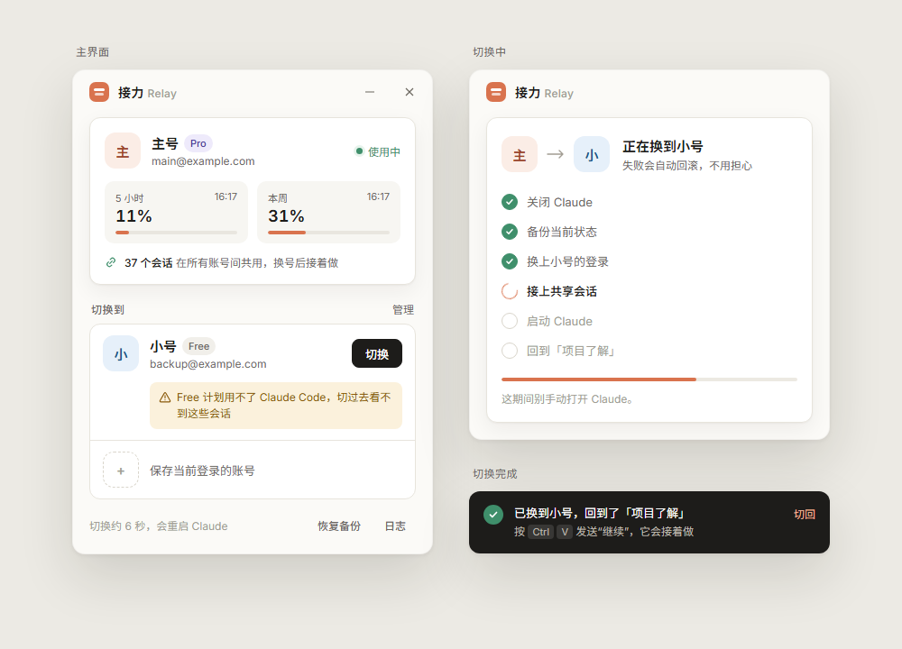

# 接力 Relay

Claude 桌面端多账号切换工具（Windows）。一个号的额度用完，点一下换到另一个号，**会话列表跟着走，切过去自动回到刚才那个会话**，接着干。



## 能做什么

- **一键换号**：自动关闭 Claude → 换上目标账号的登录状态 → 重新打开，大约 6 秒
- **会话共用**：所有账号共用同一份 Claude Code 本地会话列表，换号后列表不变
- **回到原会话**：切换完成后自动打开切换前正在用的会话，并把“继续”放进剪贴板，`Ctrl+V` 发送即可让它接着做
- **用量一眼看**：显示每个账号最近记录的 5 小时 / 本周用量
- **安全兜底**：每次切换前自动备份，失败自动回滚，也可以手动「恢复备份」
- 单个 exe，约 100 KB，使用系统自带的 .NET Framework 4.8，不需要装运行库；全程本地操作，不联网

## 下载和安装

1. 到 [Releases](../../releases) 下载 `ClaudeRelay.exe`
2. 双击运行，出现安装窗口：
   - 点 **安装**：默认装到 `%LOCALAPPDATA%\Programs\ClaudeRelay`（可点「更改」换位置），添加开始菜单（可选桌面）快捷方式，之后在「设置 → 应用」里卸载；不需要管理员权限。下载了新版再双击，就是更新
   - 点左下角 **不安装，直接运行**：在当前文件夹运行，数据放在旁边新建的 `ClaudeRelay-data` 文件夹

需要先装好 [Claude 桌面版](https://claude.ai/download)，应用商店版和官网安装版都支持。

exe 没有代码签名，Windows 可能提示“未知发布者”，点「更多信息 → 仍要运行」。

## 第一次使用

1. 在 Claude 里登录第一个账号，打开接力，点「保存这个号」
2. 在 Claude 里退出，登录第二个账号，回到接力再点一次保存
3. 之后在账号卡片上点「切换」即可

## 能保留什么，不能保留什么

| 跟着走 | 不跟着走 |
|---|---|
| Claude Code 本地会话（代码页里“本电脑”环境的会话） | 聊天页的对话、Projects（存在 Anthropic 服务器，按账号隔离） |
| 会话列表、分组、归档状态 | 云端环境的 Claude Code 会话 |
| 项目文件、CLAUDE.md | 连接器 / MCP 授权（按账号授权，可能要重新连接） |

注意：

- Claude Code 需要 Pro 及以上计划。Free 账号切过去看不到代码页的会话，界面上会提示。
- 切换会重启 Claude，正在回复的那一轮会中断，切过去后在同一个会话里发“继续”即可。

## 数据存在哪里

| | 位置 |
|---|---|
| 安装版 | `%LOCALAPPDATA%\ClaudeRelay` |
| 不安装 | exe 旁边的 `ClaudeRelay-data` |
| 自定义 | 环境变量 `CLAUDE_RELAY_HOME` |

里面有 `profiles`（各账号的登录状态快照，**含登录凭证，不要分享**）、`backups`（切换前的备份）和 `logs`。

各账号共用的会话列表放在 Claude 自己的数据目录 `%LOCALAPPDATA%\Claude-Data\claude_*\claude-switch-shared`，原来按账号分开的目录会换成指向它的目录联接。卸载接力不会影响这些会话。

## 构建

```powershell
powershell -ExecutionPolicy Bypass -File build.ps1
```

输出 `dist\ClaudeRelay.exe`。只用系统自带的 `csc.exe`（.NET Framework 4.8），不需要 .NET SDK 或 Visual Studio。

测试：

```powershell
$fw = "$env:WINDIR\Microsoft.NET\Framework64\v4.0.30319"
& "$fw\csc.exe" /nologo /out:tests\TestHarness.exe "/r:$fw\System.Web.Extensions.dll" "/r:$fw\System.Drawing.dll" "/r:$fw\System.Windows.Forms.dll" "/r:$fw\WPF\PresentationFramework.dll" "/r:$fw\WPF\PresentationCore.dll" "/r:$fw\WPF\WindowsBase.dll" "/r:$fw\System.Xaml.dll" src\Engine.cs src\Installer.cs src\InstallWindow.cs src\FolderPicker.cs src\MainWindow.cs tests\TestHarness.cs
tests\TestHarness.exe
```

测试在临时目录里模拟两个账号的切换，不会碰你真实的 Claude 数据。

## 源码结构

- `src/Engine.cs`：找到 Claude 数据目录、关闭和启动 Claude、账号快照抓取与还原、会话共享、回到原会话、用量读取、备份回滚
- `src/MainWindow.cs`：界面（WPF，纯代码构建）
- `src/Installer.cs`：安装、卸载、旧数据迁移
- `src/InstallWindow.cs`：安装 / 卸载窗口
- `src/Program.cs`：入口、单实例
- `design/`：界面设计稿（HTML）

## 免责声明

本项目与 Anthropic 无关。多账号轮换使用可能违反 Anthropic 的使用条款，有封号风险，请自行判断。工具只在本机切换登录状态，不能保证账号之间不被关联。

## 许可证

[MIT](LICENSE)
